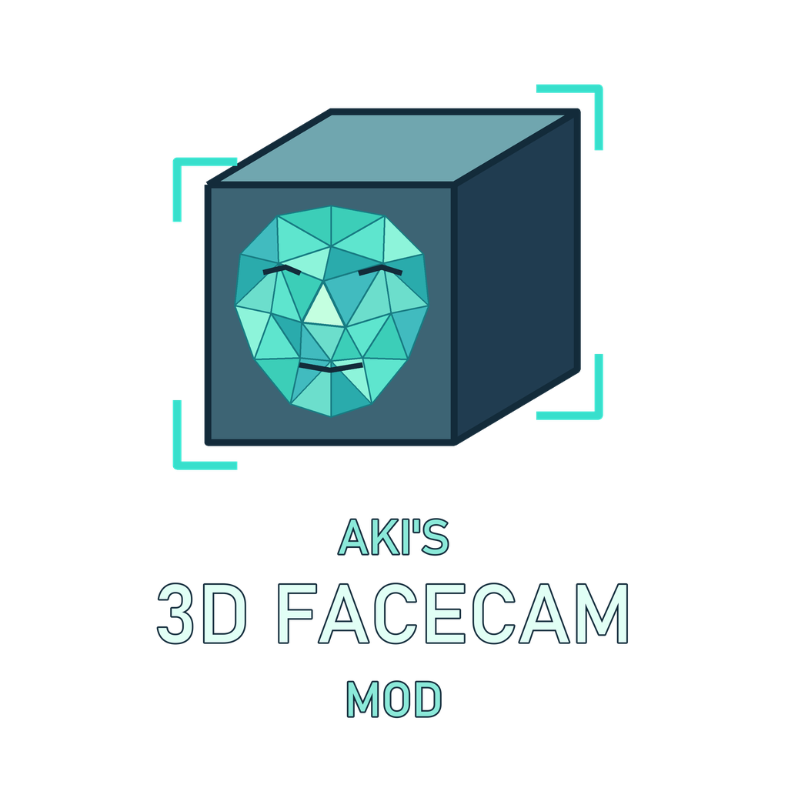
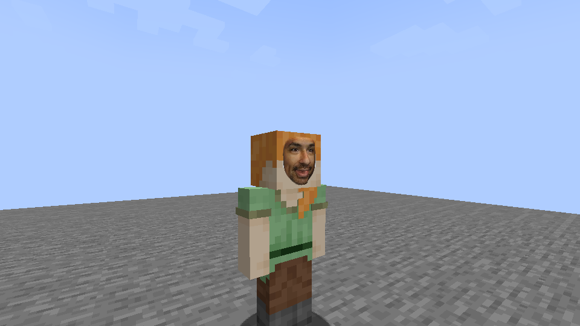

# Aki's 3D FaceCam Mod

  

**[Product of Achilleus](https://linktr.ee/achilleus_)** — original mod and maintenance by [Achilleus (Achilleus-1)](https://github.com/Achilleus-1).

Unofficial Minecraft mod; not approved by or affiliated with Mojang or Microsoft.

Put your live face on your Minecraft character. An ordinary RGB webcam drives a textured triangle mesh with approximate nose, cheek, brow, and lip depth. Expressions animate while the surface stays attached to the player's existing head. Local inference removes the surrounding background; nearby players receive the effect through the connected modded server.

**Public beta · 1.1.0-beta.1.** Camera and sharing start **off**. No audio, cloud inference, Python installation, or manually launched companion app.

## Preview

Actual Minecraft capture from the earlier 1.1.0 implementation, using a repeatable public test photograph and synthetic updates. This demonstrates the renderer; **live webcam behavior remains unverified** because the test environment's camera could not open. See [verification and remaining tests](VERIFICATION.md).

## Installation

For **Minecraft 1.21.1**, **NeoForge 21.1.259**, **Java 21**, and **Windows x64 clients**.

1. Download `akis-3d-facecam-mod-1.21.1-1.1.0-beta.1.jar` from the [beta release](https://github.com/Achilleus-1/Akis-3D-FaceCam-Mod/releases/tag/v1.1.0-beta.1).
2. Place it in your NeoForge profile's `mods` folder and remove older FaceCam jars.
3. For multiplayer, install the same beta on the server and participating clients. Players may receive faces without enabling their own webcam. Singleplayer uses the integrated server automatically.
4. Launch Minecraft, join a world, and open settings with **comma**. Choose a camera and use **Local preview** or **Start sharing** explicitly.

The installable jar bundles Windows native libraries and trained models, so it is approximately **129 MiB**. No extra mod dependencies are required. Dedicated servers do not initialize capture, inference, or graphics. Only Windows x64 clients support capture in this beta.

## Controls and settings

| Control | Default / behavior |
| --- | --- |
| Open settings | **`,`** or Mods → Aki's 3D FaceCam Mod → Config |
| Toggle sharing | **`.`**, while connected to a world |
| Rebind controls | Options → Controls → Key Binds → Aki's 3D FaceCam Mod |
| Face depth | **1.75 units**, adjustable **0–6** |
| Face size | **100%**, adjustable **10%–400%**; **Reset size** restores the original proportions |
| Video | **128 × 128 at 15 FPS** by default; resolution/FPS adjustable |
| Tracking smoothing | Adjustable; **45%** default |
| Received faces | Hide other players' face surfaces locally |

Skin and head equipment remain visible. Completely transparent outer-front skin pixels allow full depth; visible outer-front pixels and helmets conservatively limit protrusion to keep the face beneath coverings. Sizes over 100% intentionally extend beyond the normal head footprint.

Stopping sharing releases the camera and restores normal skins for viewers. The sharing status remains visible while active. Client preferences are saved in `config/facecam-client.json`; server distance and frame/bandwidth limits are in `config/facecam-server.toml`.

See the [full setup, configuration, troubleshooting, and architecture guide](docs/GUIDE.md). Share only on servers you trust with your face imagery.

## Development

Build with a **Java 21 JDK**: `./gradlew build` on Linux/macOS or `.\gradlew.bat build` on Windows. The installable jar is written to `build/libs/`. The first build downloads pinned Gradle, NeoForge, and Maven dependencies. Windows GitHub Actions repeats repository checks and the build/tests on pushes and pull requests.

Source code is in `src/main/java/`; metadata, translations, icons, and bundled models are in `src/main/resources/`. Versions are configured in `gradle.properties`. The existing `facecam` internal ID, packet IDs, Java packages, and configuration paths are preserved.

See [DEVELOPMENT.md](DEVELOPMENT.md) for the project layout, packaging, and diagnostic commands; [CHANGELOG.md](CHANGELOG.md) for changes; [CONTRIBUTING.md](CONTRIBUTING.md) for contributions; and [SECURITY.md](SECURITY.md) for private reports. [Branding assets](BRANDING.md) include the cover, packaged icon, and social preview.

## License and credits

**Apache-2.0** — see [LICENSE](LICENSE), [LEGAL.md](LEGAL.md), [NOTICE](NOTICE), and [third-party notices](THIRD_PARTY_NOTICES.md).

Face models and canonical geometry derive from Google MediaPipe, with ONNX exports by Yakhyokhuja Valikhujaev. Bundled dependencies retain their own licenses. This is an approximate monocular reconstruction; occlusion, profile views, low light, and extreme expressions can degrade tracking. Live webcam, clean Windows install, and broad mod/shader compatibility testing remain open beta work.
